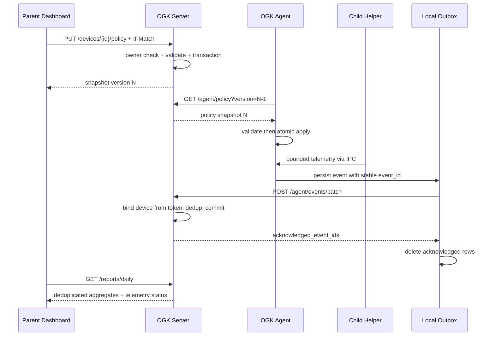

# API v1 — OpenGuard Kids

**Mã công việc:** TV1-A01. Contract/schema mẫu nằm trong [contracts/schemas](../contracts/schemas/README.md) và [fixtures](../contracts/fixtures/README.md). Đây là thiết kế, chưa có server runtime/OpenAPI.

## 1. Quy ước chung

- Prefix: `/api/v1`; JSON UTF-8; timestamps RFC 3339 UTC (`Z`); IDs UUID.
- Parent: server-managed session cookie, HttpOnly/SameSite, Secure khi HTTPS; mutation cần CSRF. Parent ID luôn từ session, không nhận qua body.
- Agent: bearer token riêng device; token hash lưu server; revoke làm mất quyền. Device identity suy ra từ token, không cho body chọn `device_id`.
- Tất cả parent query/mutation kiểm tra ownership qua device → child → owner. Agent chỉ được thao tác trên device gắn với token.
- Policy update dùng `If-Match: "<version>"` hoặc `expected_version`; snapshot tăng version atomically. Stale version trả `409 VERSION_CONFLICT`.
- Schedule `day_of_week` dùng `0=Monday` đến `6=Sunday` (quy ước Python); giờ local theo IANA timezone trong device policy, interval `[start,end)`.
- Event batch dedup theo `(device_id,event_id)`; server commit rồi mới trả `acknowledged_event_ids`. Retry dùng lại IDs.
- Command `delivered` chỉ nghĩa agent đã nhận; `executed` chỉ sau kết quả thực tế theo loại command. Không bảo đảm exactly-once với OS effect.

## 2. Parent endpoints

| Method/path | Auth | Ý nghĩa / response |
|---|---|---|
| `POST /auth/login` | Public + rate limit | Xác thực; set session cookie. Body `{email,password}`. |
| `POST /auth/logout` | Parent + CSRF | Revoke session; `204`. |
| `GET /auth/me` | Parent | User/session summary, không trả secret. |
| `GET /children` | Parent | Danh sách child thuộc owner. |
| `POST /children` | Parent + CSRF | Tạo child `{display_name, age_band?, timezone}`. |
| `PATCH /children/{child_id}` | Parent + CSRF | Sửa child nếu ownership đúng. |
| `POST /enrollment-codes` | Parent + CSRF | Tạo one-time code; trả code một lần và expiry, không lưu/plaintext log. |
| `GET /devices` | Parent | Chỉ devices thuộc owner; connection/applied version metadata. |
| `POST /devices/{device_id}/revoke` | Parent + CSRF | Revoke credential; audit; `204`. |
| `GET /devices/{device_id}/policy` | Parent | Snapshot/version hiện hành. |
| `PUT /devices/{device_id}/policy` | Parent + CSRF + `If-Match` | Validate policy, create immutable next version, audit; trả snapshot mới. |
| `GET /requests?status=pending` | Parent | Requests thuộc owner, phân trang. |
| `POST /requests/{request_id}/decision` | Parent + CSRF | `{decision: approved|rejected, grant?}`; một transition atomic, trả request và grant nếu tạo. |
| `POST /devices/{device_id}/commands` | Parent + CSRF | Tạo allowlisted command có expiry; trả `queued`, chưa phải executed. |
| `GET /reports/daily` | Parent | Filter `device_id`, `date`; timezone của device; usage/block counts/delayed indicators. |
| `GET /reports/weekly` | Parent | Filter `device_id`, `week_start`; tuần theo local date. |
| `GET /audit` | Parent | Filter/paginate audit thuộc owner; secrets đã redacted. |

## 3. Agent endpoints

| Method/path | Auth | Ý nghĩa / response |
|---|---|---|
| `POST /agent/enroll` | Enrollment code + TLS | Consume code một lần; gắn device; trả token device một lần + initial config. Không nhận owner/device identity làm authority từ client. |
| `GET /agent/policy?version={n}` | Device bearer | Trả current immutable policy nếu version khác, hoặc `304`; device được suy ra từ token. |
| `POST /agent/heartbeat` | Device bearer | `last_seen`, applied policy version, agent version, bounded health state; server trả desired policy version/command hint. |
| `POST /agent/events/batch` | Device bearer | Bounded batch event; dedup/commit; trả ACK ID list sau commit. |
| `POST /agent/requests` | Device bearer | Tạo/nhận lại request theo stable request ID; server gắn device. |
| `GET /agent/commands` | Device bearer | Poll queued commands cho đúng device; lệnh hết hạn trả/đánh dấu expired, không deliver để chạy muộn. |
| `POST /agent/commands/{command_id}/ack` | Device bearer | Result `{status: executed|failed, observed_at, result_code}`; idempotent, command phải thuộc token device. |

Heartbeat 60s và command polling ~5s là target ban đầu; jitter/backoff và server load phải được đo. Agent luôn kết nối outbound; server không mở kết nối vào máy trẻ.

## 4. Policy-to-event flow



## 5. Contracts và state models

- Schema files dùng JSON Schema Draft 2020-12, `schema_version: 1`; unknown properties bị reject trừ khi schema nói rõ.
- Policy: `policy.schema.json`; command: `command.schema.json`; request: `request.schema.json`; grant: `grant.schema.json`; event: `event.schema.json`; IPC: `ipc_message.schema.json`; ACK: `command_ack.schema.json`.
- Request: `pending → approved | rejected | expired`, chỉ một lần bằng conditional transaction.
- Command: `queued → delivered → executed | failed`; `queued/delivered → expired` khi quá hạn. Không dùng `delivered` như bằng chứng tác động.
- Grant dùng ID cố định theo source request/command; retry không thay `valid_until` hoặc tăng amount lần nữa.
- Exemption thời gian bỏ schedule/quota trong scope; không bỏ manual lock hoặc app/domain block. App exception chỉ bypass app block được duyệt, không total quota.

## 6. Error envelope

Mọi lỗi JSON có dạng:

```json
{
  "error": {
    "code": "VERSION_CONFLICT",
    "message": "Policy version is stale.",
    "request_id": "5f2d5a78-7fb7-43dd-9dd7-c3f12fa87b81",
    "details": [{"field": "expected_version", "reason": "does_not_match"}]
  }
}
```

Status tối thiểu: `400` validation, `401` missing/invalid auth, `403` forbidden/revoked/CSRF, `404` unknown or not-owned resource (không lộ ownership), `409` version/state conflict/dedup key mismatch, `422` schema/semantic validation, `429` rate limit, `503` retryable dependency unavailable. Error message không chứa token/secret.

## 7. A01 review checklist

TV2 review schedule/quota/event/command/grant/IPC semantics và việc core parse schema độc lập Windows. TV3 review form-facing request/error/status semantics và version/ACK display. TV1 tổng hợp thay đổi trước khi contract v1 được dùng trong implementation; review chưa diễn ra ở A01 nếu chưa có xác nhận nhóm.
