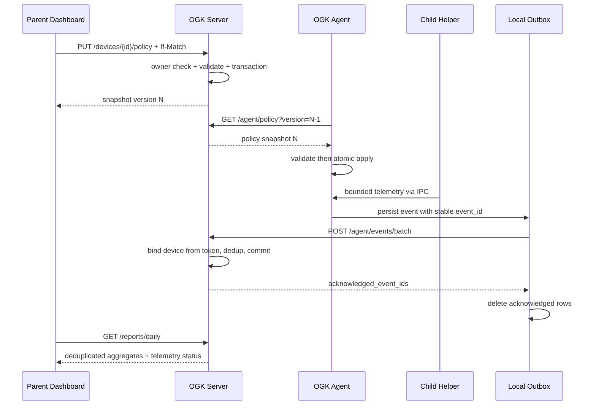

# API v1 — OpenGuard Kids

**Mã công việc:** TV1-A01. Contract/schema mẫu nằm trong [contracts/schemas](../contracts/schemas/README.md) và [fixtures](../contracts/fixtures/README.md). API v1 đang được triển khai theo từng task; auth và enrollment/device-token endpoints đã có runtime.

## 1. Quy ước chung

- Prefix: `/api/v1`; JSON UTF-8; timestamps RFC 3339 UTC (`Z`); IDs UUID.
- Parent: server-managed session cookie, HttpOnly/SameSite, Secure khi HTTPS; mutation cần CSRF. Session sống 12 giờ, logout revoke server-side. Parent ID luôn từ session, không nhận qua body.
- Auth: Argon2id, mật khẩu tối thiểu 10 ký tự, 5 lần sai khóa 15 phút theo `(email, IP)`; không trả phân biệt tài khoản/mật khẩu qua response ngoài thông báo auth chung.
- Agent: opaque bearer access token 15 phút và opaque refresh token 30 ngày; token verifier/hash lưu server. Refresh token rotate mỗi lần dùng; dùng lại token cũ revoke credential. Device identity suy ra từ bearer credential, không cho body chọn `device_id`.
- Enrollment code: 8 ký tự từ alphabet không có `I`, `O`, `0`, `1`; hạn 10 phút, một lần dùng, gắn với child cụ thể. Hash dùng HMAC-SHA256 với `OGK_ENROLLMENT_PEPPER` (tối thiểu 32 bytes); secret chỉ trả một lần. Sai 5 lần trong 15 phút từ một IP sẽ bị khóa 15 phút.
- Tất cả parent query/mutation kiểm tra ownership qua device → child → owner. Agent chỉ được thao tác trên device gắn với token.
- Policy update dùng `If-Match: "<version>"` hoặc `expected_version`; snapshot tăng version atomically. Stale version trả `409 VERSION_CONFLICT`.
- Snapshot policy có chữ ký Ed25519 trên canonical JSON (UTF-8, key sort, compact separators) của envelope `{algorithm,key_id,snapshot}`; trường chữ ký không nằm trong bytes được ký. Server giữ private key; agent chỉ giữ các public key tin cậy.
- Agent kiểm tra signature, `device_id` cục bộ và không nhận version thấp hơn version đã áp dụng; schema/chữ ký/device/version không hợp lệ thì không được thay cache policy.
- Schedule `day_of_week` dùng `0=Monday` đến `6=Sunday` (quy ước Python); giờ local theo IANA timezone trong device policy, interval `[start,end)`.
- Event batch dedup theo `(device_id,event_id)`; server commit rồi mới trả `acknowledged_event_ids`. Retry dùng lại IDs.
- Command `delivered` chỉ nghĩa agent đã nhận; `executed` chỉ sau kết quả thực tế theo loại command. Không bảo đảm exactly-once với OS effect.

## 2. Parent endpoints

| Method/path | Auth | Ý nghĩa / response |
|---|---|---|
| `POST /auth/login` | Public + rate limit | Xác thực; set session cookie. Body `{email,password}`. |
| `POST /auth/logout` | Parent + CSRF | Revoke session; `204`. |
| `GET /auth/me` | Parent | User/session summary, không trả secret. |
| `GET /children` | Parent | Danh sách child thuộc owner. |
| `POST /children` | Parent + CSRF | Tạo child `{display_name, age_band?, timezone}`. |
| `PATCH /children/{child_id}` | Parent + CSRF | Sửa child nếu ownership đúng. |
| `POST /enrollment-codes` | Parent + CSRF | Body `{child_id}`; tạo code 8 ký tự, hạn 10 phút, gắn child thuộc parent; trả code đúng một lần. |
| `GET /devices` | Parent | Chỉ devices thuộc owner; connection/applied version metadata. |
| `POST /devices/{device_id}/revoke` | Parent + CSRF | Revoke device và credential; audit; `204`. |
| `GET /devices/{device_id}/policy` | Parent | Snapshot/version hiện hành. |
| `PUT /devices/{device_id}/policy` | Parent + CSRF + `If-Match` hoặc `expected_version` | Body `{policy, expected_version?}`; validate schema, create immutable signed next version, audit; trả ETag và snapshot mới. `If-Match` phải là version quoted; lần đầu dùng version `0`. |
| `GET /requests?status=pending` | Parent | Requests thuộc owner, phân trang. |
| `POST /requests/{request_id}/decision` | Parent + CSRF | `{decision: approved|rejected, grant?}`; một transition atomic, trả request và grant nếu tạo. |
| `POST /devices/{device_id}/commands` | Parent + CSRF | Tạo allowlisted command có expiry và dedup key; trả `queued`, chưa phải executed. |
| `GET /devices/{device_id}/commands` | Parent | Lịch sử command và lifecycle hiện tại của đúng device. |
| `GET /reports/daily` | Parent | Filter `device_id`, `date`; timezone của device; usage/block counts/delayed indicators. |
| `GET /reports/weekly` | Parent | Filter `device_id`, `week_start`; tuần theo local date. |
| `GET /audit` | Parent | Filter/paginate audit thuộc owner; secrets đã redacted. |

## 3. Agent endpoints

| Method/path | Auth | Ý nghĩa / response |
|---|---|---|
| `POST /agent/enroll` | Enrollment code + TLS | Body `{code,name,windows_sid?}`; consume atomically, gắn device với child đã bind; trả access/refresh token một lần. Không nhận owner/device identity làm authority từ client. |
| `POST /agent/refresh` | Refresh token + TLS | Body `{refresh_token}`; rotate refresh token và access token. Replay refresh token cũ revoke credential. |
| `GET /agent/me` | Device bearer | Kiểm tra bearer token chưa hết hạn/revoke; trả device identity suy ra từ token. |
| `GET /agent/policy?version={n}` | Device bearer | Trả current immutable signed policy nếu version khác, hoặc `304`; device được suy ra từ token. Agent phải validate schema/chữ ký trước khi atomic apply; lỗi giữ policy tốt trước. |
| `POST /agent/heartbeat` | Device bearer | Body `{applied_policy_version,agent_version,health}` (health tối đa 8 trường); server suy ra identity từ bearer, cập nhật `last_seen_at/applied_policy_version` và trả `server_time,desired_policy_version,connection_state`. Ngoài 180 giây không nhận heartbeat, trạng thái là mất liên lạc nhưng không suy ra thiết bị đã tắt. |
| `POST /agent/events/batch` | Device bearer | Nhận `{events}` tối đa 100 envelope; validate allowlist payload, dedup atomically theo `(device_id,event_id)`, commit rồi mới trả `acknowledged_event_ids,accepted_count,replayed_count,server_time`. Replay/lost ACK không nhân usage hoặc event. |
| `POST /agent/requests` | Device bearer | Tạo/nhận lại request theo stable request ID; server gắn device. |
| `GET /agent/commands` | Device bearer | Poll queued commands cho đúng device; lệnh hết hạn trả/đánh dấu expired, không deliver để chạy muộn. |
| `POST /agent/commands/{command_id}/ack` | Device bearer | Result `{status: executed|failed|expired, observed_at, result_code}`; idempotent, replay cùng kết quả không nhân audit, command phải thuộc token device. |
| `WS /agent/commands/notify?access_token=...` | Device access token | Notification chỉ phát `command.created` với `command_id`; polling và queue vẫn là authority, reconnect không mất intent. |

Heartbeat 60s và command polling ~5s là target ban đầu; jitter/backoff và server load phải được đo. Agent luôn kết nối outbound; server không mở kết nối vào máy trẻ.

Enrollment code chỉ được tạo với `OGK_ENROLLMENT_PEPPER` đã cấu hình; production cần giữ giá trị này ổn định và bí mật để xác minh code đang còn hiệu lực. Thay pepper làm các enrollment code chưa dùng mất hiệu lực. Access token chỉ hợp lệ trong 15 phút; agent cần refresh trước khi hết hạn. Mọi endpoint agent phải dùng dependency xác thực device, không tự đọc `device_id` từ request body.

## 4. Policy-to-event flow



## 5. Contracts và state models

- Schema files dùng JSON Schema Draft 2020-12, `schema_version: 1`; unknown properties bị reject trừ khi schema nói rõ.
- Policy: `policy.schema.json`; command: `command.schema.json`; request: `request.schema.json`; grant: `grant.schema.json`; event: `event.schema.json`; IPC: `ipc_message.schema.json`; ACK: `command_ack.schema.json`.
- Signing key server: `OGK_POLICY_SIGNING_KEY_ID` và `OGK_POLICY_SIGNING_PRIVATE_KEY` (base64 của Ed25519 seed 32 byte). Agent tin cậy nhiều key trong `OGK_POLICY_VERIFY_PUBLIC_KEYS` (JSON map `key_id` → base64 raw public key 32 byte) để hỗ trợ xoay key; không dùng private key ở agent.
- Request: `pending → approved | rejected | expired`, chỉ một lần bằng conditional transaction.
- Command: `queued → delivered → executed | failed`; `queued/delivered → expired` khi quá hạn. Không dùng `delivered` như bằng chứng tác động.
- Grant dùng ID cố định theo source request/command; retry không thay `valid_until` hoặc tăng amount lần nữa.
- Exemption thời gian bỏ schedule/quota trong scope; không bỏ manual lock hoặc app/domain block. App exception chỉ bypass app block được duyệt, không total quota.

## 6. Error envelope

Mọi lỗi JSON có dạng:

```json
{
  "error": {
    "code": "VERSION_CONFLICT",
    "message": "Policy version is stale.",
    "request_id": "5f2d5a78-7fb7-43dd-9dd7-c3f12fa87b81",
    "details": [{"field": "expected_version", "reason": "does_not_match"}]
  }
}
```

Status tối thiểu: `400` validation, `401` missing/invalid auth, `403` forbidden/revoked/CSRF, `404` unknown or not-owned resource (không lộ ownership), `409` version/state conflict/dedup key mismatch, `422` schema/semantic validation, `428` missing policy version precondition, `429` rate limit, `503` retryable dependency unavailable. Error message không chứa token/secret.

## 7. A01 review checklist

TV2 review schedule/quota/event/command/grant/IPC semantics và việc core parse schema độc lập Windows. TV3 review form-facing request/error/status semantics và version/ACK display. TV1 tổng hợp thay đổi trước khi contract v1 được dùng trong implementation; review chưa diễn ra ở A01 nếu chưa có xác nhận nhóm.
