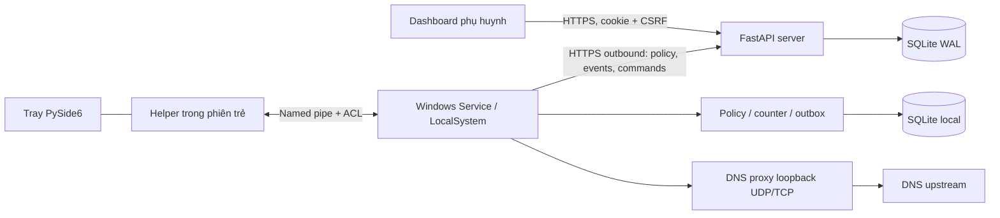

# Kiến trúc dự kiến

Trạng thái: thiết kế theo brief, chưa có implementation.

TV1 giữ backend và DNS resolver thuần; TV2 giữ agent core/Windows và DNS adapter;
TV3 giữ dashboard/Tray. Contracts là ranh giới bàn giao, không import code server vào agent.
Service không vẽ UI trên Session 0; helper gửi SID/session/foreground/idle và service xác thực.
Dashboard không kết nối trực tiếp máy trẻ. Server không gửi shell tùy ý.

Policy version tăng, apply nguyên tử; giữ bản cũ nếu invalid. Event ACK sau DB commit,
dedup và retry; command persist intent/result, expiry và grant theo command_id.
Manual lock bền vững; UI chỉ báo thành công khi có bằng chứng applied/executed.
Đọc DECISIONS.md trước khi triển khai degraded mode và fallback ngắt phiên.
