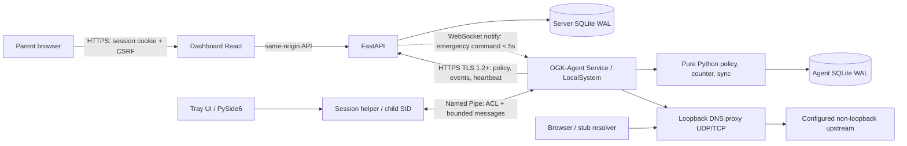

# Kiến trúc OpenGuard Kids (OGK)

**Trạng thái:** thiết kế theo PDF chính thức; đã có SRS/ERD/API contract của A01, spike B01 và core model/clock B02, nhưng chưa có hệ thống end-to-end. Đặc tả: [SRS.md](SRS.md); dữ liệu: [ERD.md](ERD.md); API: [API.md](API.md); truth table: [POLICY_RULES.md](POLICY_RULES.md); ADR: [adr/README.md](adr/README.md).

## Thành phần và ranh giới tin cậy

| Thành phần | Quyền/trách nhiệm | Không được làm |
|---|---|---|
| Dashboard | Parent session; CRUD child/device/policy, requests, commands, reports | Không kết nối trực tiếp agent; không cất device token; không báo thành công trước ACK. |
| FastAPI server | Parent auth/CSRF, ownership, enrollment, immutable policy snapshots, dedup events, requests/grants/commands, report/audit | Không nhận `device_id` agent chọn làm authority; không phát shell/code tải về. |
| Agent core | Python thuần; policy/counter/clock/outbox; không phụ thuộc Windows API | Không import Windows API; không coi telemetry thiếu là usage=0 hoặc app foreground. |
| Windows Service | LocalSystem; local DB, policy cache, command validation, enforcement, HTTPS sync | Không hiển thị UI Session 0; không tin SID/session từ IPC nếu chưa xác minh. |
| Session helper/Tray | Chạy trong phiên trẻ; foreground/idle/session signals và minh bạch UI | Không có endpoint stop service, arbitrary execution, policy write hay token server. |
| DNS proxy/adapter | Resolver loopback, rule domain, upstream; adapter change có backup/rollback | Không bind LAN/open resolver, loopback self-forward, full URL logging hay TLS interception. |

Parent browser → server là trust boundary riêng với device bearer token → server. IPC là trust boundary thứ ba: ACL giới hạn SYSTEM và SID được quản lý; Service kiểm tra message type, SID, session ID, timestamp freshness, size và bounds. Tài khoản admin của máy vẫn có thể vượt kiểm soát user-mode; OGK không tuyên bố anti-tamper tuyệt đối.

Ràng buộc chính thức: Tray phải luôn hiện khi agent chạy; nếu không thể hiện biểu tượng thì agent tự dừng thay vì chạy ẩn. Telemetry production không chứa URL đầy đủ, tiêu đề cửa sổ, nội dung gõ, ảnh màn hình hoặc nội dung riêng tư. Trẻ có role `child-view` để xem cùng báo cáo và audit của mình.

## Luồng chính

1. Parent tạo enrollment code 8 ký tự, dùng một lần và hạn 10 phút; agent enroll qua HTTPS và nhận access token 15 phút + refresh token riêng thiết bị. Server lưu hash token; revoke chặn request tiếp theo.
2. Parent ghi policy snapshot version mới có HMAC/chữ ký; agent tải, xác minh và atomic apply. Snapshot sai giữ bản trước; dashboard phân biệt server version với applied version.
3. Helper phát signals tối thiểu trong session trẻ. Agent xác nhận SID/session/freshness rồi core tính interval. Checkpoint local khoảng 5s; app foreground là tối đa một app tại một thời điểm.
4. Khi offline, agent dùng policy/counter/grants còn hạn và queue request/events; không tự approve. Reconnect gửi retry với ID ổn định; server dedup và ACK sau commit.
5. Command đi theo queued → delivered → executed/failed/expired. WebSocket chỉ thông báo nhanh; command queue/polling vẫn là fallback bền vững. `delivered` không chứng minh OS effect; lock chỉ ACK executed sau xác nhận đúng trạng thái.
6. DNS adapter chỉ đổi sau backup và proxy health check; upstream không được là loopback. Apply lỗi thì rollback; uninstall restore DHCP/static IPv4/IPv6 đã lưu.

## Session, telemetry và lock semantics

Service chạy ở Session 0; API dựa trên interactive desktop không thể được gọi như thể Service đang ở phiên trẻ. `GetLastInputInfo` là session-specific; gọi từ helper mới đo idle của session đó. `LockWorkStation` chỉ gọi ở interactive desktop, chạy bất đồng bộ và return thành công chỉ nghĩa là request được khởi tạo. `WTSEnumerateSessions` cung cấp connection state (`WTSActive`, `WTSDisconnected`...), không phải trạng thái locked/unlocked. `WTSDisconnectSession` disconnect session và không tương đương khóa workstation.

Khi helper mất, Service báo degraded và khoảng telemetry thiếu; không tự suy diễn foreground/idle. Việc đếm tổng hoặc enforcement process khi degraded chỉ được chấp nhận nếu có nguồn đo độc lập được kiểm chứng và lọc đúng SID/session. Recovery helper phải có backoff/rate limit, không tạo restart loop.

## Data, retry và failure behavior

- Server và agent SQLite bật `journal_mode=WAL` và `busy_timeout=5000` mỗi connection; server lab chạy một worker.
- Time lưu UTC; schedule/report theo timezone thiết bị. Counter dùng monotonic trong boot, high-water local date để phát hiện clock rollback; không nhận khả năng chống chỉnh giờ qua reboot tuyệt đối.
- Event unique theo `(device_id,event_id)`; outbox chỉ xóa sau ACK. `device_id` agent được gắn từ token, không từ payload.
- Policy version immutable, có HMAC/chữ ký; apply không hợp lệ giữ version hoạt động trước.
- Agent dùng TLS 1.2+ và certificate pinning. Secret local nằm trong ProgramData với ACL SYSTEM/Administrators và được bảo vệ bằng DPAPI hoặc cơ chế tương đương.
- Command/grant dùng ID cố định qua retry; expiry được kiểm trước khi thực thi; không tuyên bố exactly-once cho OS side effect.
- Nếu không có policy/enrollment, trạng thái là “chưa quản lý”; không đổi DNS/chặn máy.
- DoH/VPN/DNS cache/connection đã mở có thể vượt hoặc trì hoãn web rule; không giải mã HTTPS và không ghi full query history.

## Phân chia và trạng thái

Theo PHAN_CONG: TV1 backend/contracts/resolver; TV2 core/Windows/DNS adapter; TV3 dashboard/Tray. Contracts là ranh giới; agent không import server code.

Spike Windows nằm ở [agent/spikes](../agent/spikes/README.md); checklist ở [CHECKLIST.md](../agent/windows/CHECKLIST.md). B01 đã smoke-test read-only trên Windows host nhưng chưa nghiệm thu VM hai tài khoản/Session 0; xem [PROGRESS.md](PROGRESS.md).
