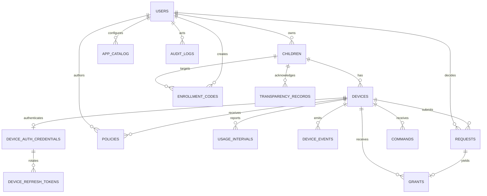

# ERD và data dictionary — OpenGuard Kids

**Mã công việc:** TV1-A01  
**Trạng thái:** logical model ban đầu; server ORM/migration đang được triển khai theo A02–A04.

## Quan hệ

Parent resource query bắt buộc scope `child.owner_id = authenticated_user.id`. Với agent, `device_id` lấy từ credential server đã xác thực, không tin giá trị payload.

## Server data dictionary

| Entity | Khóa/trường chính | Quan hệ/ràng buộc |
|---|---|---|
| `users` | `id`, `email`, `password_hash`, `created_at` | Email normalized unique; password chỉ lưu hash. |
| `children` | `id`, `owner_id`, `display_name`, `age_band`, `timezone` | FK `owner_id`; timezone IANA hợp lệ. |
| `devices` | `id`, `child_id`, `windows_sid`, `name`, `token_hash`, `last_seen_at`, `applied_policy_version`, `revoked_at` | FK child; access bearer hash (15 phút), revoke device-scoped; index child. |
| `device_auth_credentials` | `id`, `device_id`, `access_expires_at`, `refresh_expires_at`, `revoked_at`, `created_at` | Một credential/device; expiry và revoke access/refresh cùng family. |
| `device_refresh_tokens` | `id`, `credential_id`, `token_hash`, `expires_at`, `consumed_at`, `created_at` | Hash unique; mỗi refresh consume token cũ và tạo token mới; replay revoke credential. |
| `enrollment_codes` | `id`, `owner_id`, `child_id`, `code_prefix`, `code_hash`, `expires_at`, `consumed_at`, `attempt_count` | HMAC verifier; 8 ký tự, one-time/10 phút; gắn child; consume cùng transaction tạo device. |
| `enrollment_attempts` | `ip_address`, `failed_count`, `window_started_at`, `locked_until` | 5 lần sai trong 15 phút khóa IP thêm 15 phút; không lưu code/token plaintext. |
| `policies` | `id`, `device_id`, `version`, `document_json`, `created_by`, `created_at` | Snapshot bất biến; unique `(device_id, version)`. |
| `app_catalog` | `id`, `owner_id`, `display_name`, `normalized_exe_name/path`, `category` | App do parent cấu hình; không suy ra usage từ app nền. |
| `usage_intervals` | `id`, `event_id`, `device_id`, `start_utc`, `end_utc`, `active_seconds`, `app_id`, `sequence`, `boot_id` | Unique `(device_id,event_id)`; `end > start`; app seconds là tập con machine seconds. |
| `device_events` | `id`, `event_id`, `device_id`, `event_type`, `observed_at`, `reason_code`, `payload_json` | Unique `(device_id,event_id)`; schema/size bounded; không full URL/secret. |
| `requests` | `id`, `device_id`, `request_type`, `payload_json`, `reason`, `status`, `decided_by`, timestamps | Conditional state transition; parent decision ownership; index device/status/time. |
| `grants` | `id`, `request_id`, `device_id`, `scope_json`, `valid_from`, `valid_until`, `amount_seconds`, `local_date` | `request_id` unique nullable; stable `grant_id`; bounds and expiry validated. |
| `commands` | `id`, `device_id`, `type`, `payload_json`, `expires_at`, `status`, `dedup_key`, `result_json` | Allowlisted type; unique `(device_id,dedup_key)`; delivered != executed. |
| `audit_logs` | `id`, `actor_user_id`, `device_id`, `action`, `resource_type/id`, filtered before/after, `created_at` | Filter secrets; index actor/time and device/time; retention riêng. |
| `transparency_records` | `id`, `child_id`, `explanation_version`, `acknowledged_at` | Ghi UI acknowledgment, không phải chứng nhận pháp lý. |

## Agent local data

| Table | Dữ liệu | Invariant |
|---|---|---|
| `policy_cache` | Snapshot hiện hành, version, applied time | Validate trước khi atomic apply; lỗi giữ snapshot tốt trước. |
| `usage_checkpoints` | Counter, boot ID, monotonic/wall sample, high-water local date | Checkpoint mục tiêu 5s; không cộng gap mù sau sleep/crash. |
| `outbox_events` | Event/request chờ ACK | ID cố định qua retry; chỉ xóa sau ACK server. |
| `executed_commands` | Intent/result theo `command_id` | Unique command ID; expiry/result bất biến, duplicate không gia hạn grant. |
| `active_grants` | Grants đã nhận/applied | Unique grant ID; scope, local date và expiry rõ. |
| `dns_original_settings` | Adapter, address family, DHCP/static, DNS servers | Key `(adapter_id,address_family)`; restore idempotent. |

Local DB/token nằm trong thư mục ACL của service/admin; SQLite connection bật WAL và `busy_timeout=5000`. Tray không ghi trực tiếp database.

## Transaction, indexes và retention

- Bật foreign keys; unique keys cho event, policy version, command dedup và grant idempotency.
- Enrollment: verify code/expiry/attempts, create device và consume code trong một transaction.
- Policy update: `If-Match`/expected version; insert snapshot mới, không overwrite lịch sử.
- Parent decision: conditional update từ `pending`; tạo grant và audit cùng transaction; rowcount != 1 trả conflict.
- Event ingest: insert dedup rows và trả ACK IDs chỉ sau commit.
- Command ACK: conditional state transition + filtered result; OS effect không thể được bảo đảm exactly-once bởi DB.
- Report index theo device/time; event/usage retention mặc định lab 30 ngày, audit 90 ngày (cần cấu hình/test ở milestone implementation).

## Chưa chốt trong A01

Schema migration/versioning, identity behavior khi Windows SID đổi sau reinstall, PostgreSQL migration, retention job và cách chuẩn hóa payload sau khi có dữ liệu thực. Những điểm này không thay đổi ownership, dedup hoặc privacy invariants.
