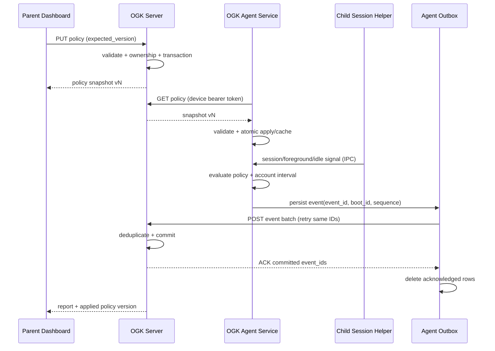

# SRS — OpenGuard Kids (OGK)

**Mã công việc:** TV1-A01
**Trạng thái:** đề xuất để TV2/TV3 review; chưa phải mô tả implementation.
**Nguồn:** [PROJECT_BRIEF.md](PROJECT_BRIEF.md), 9 prototype được liệt kê tại [reference/README.md](reference/README.md).

## 1. Mục đích và phạm vi

OGK cho phép phụ huynh cấu hình lịch và giới hạn trên dashboard; agent Windows nhận/cache policy và đo usage tối thiểu trong phiên trẻ; trẻ xem trạng thái, giải thích và gửi request; server nhận event đã dedup để tạo báo cáo. DNS proxy lọc domain, không giải mã HTTPS.

MVP demo: một Windows device được quản lý, một phụ huynh, một trẻ standard-user và tối đa một phiên trẻ hoạt động trên mỗi device. Server lưu được nhiều gia đình/device; quota riêng theo device, không phải quota chung đa máy offline.

**MVP:** parent auth, children/device pairing, policy theo version, schedule/quota, foreground usage, app rule, Tray transparency/request, parent decision/grants, allowlisted commands, offline cache/outbox, report/audit và DNS domain filter có restore.

**Mở rộng sau MVP ổn định:** WebSocket notify, SafeSearch/YouTube sau adapter/test, 2FA, CSV, age templates và installer tiện dụng.

**Ngoài phạm vi:** screenshot/webcam/keylogger/tin nhắn/full URL, shell hoặc remote code, driver/kernel, chống administrator, chặn tuyệt đối VPN/DoH, AI web classification, quota atomic đa máy offline, hỗ trợ nhiều OS.

## 2. Actors và use cases

| Actor | Mô tả/quyền |
|---|---|
| Phụ huynh | Quản lý hồ sơ/thiết bị, cấu hình policy, duyệt request, phát command, đọc report/audit; chỉ được truy cập tài nguyên thuộc mình. |
| Trẻ / standard user | Xem lý do/trạng thái minh bạch và tạo request; không tự duyệt, sửa policy hay nhận quyền quản trị. |
| OGK-Agent Service | LocalSystem; xác thực device token, lưu cache/outbox, tính policy và thực thi giới hạn được cấu hình; không hiển thị UI. |
| Session helper / Tray | Chạy trong interactive session của trẻ; gửi foreground/idle/session signals và cung cấp UI. Dữ liệu IPC luôn phải validate tại Service. |
| OGK-Server | Auth, ownership, policy snapshot, requests/grants/commands, event ingestion/dedup, report/audit. |
| DNS proxy / lab operator | Proxy xử lý domain; operator cài đặt/backup/restore trong VM theo quy trình có preflight. |

| Use case | Luồng chính |
|---|---|
| UC-01 Pair device | Parent tạo code ngắn hạn one-time; agent enroll qua HTTPS; server cấp token device riêng; parent thu hồi được token. |
| UC-02 Configure policy | Parent sửa lịch/quota/app/domain rules; server tạo snapshot version mới; agent tải/validate/apply và báo applied version. |
| UC-03 Observe usage | Helper phát tín hiệu phiên/foreground/idle; agent tính interval theo policy; outbox đồng bộ event; dashboard phân biệt dữ liệu trễ/thiếu. |
| UC-04 Request exception | Trẻ xin thêm thời gian/mở app; offline queue hiển thị “chưa gửi”; parent approve/reject đúng một lần. |
| UC-05 Command device | Parent lock/clear lock/temporary exemption; command có expiry; agent trả trạng thái queued/delivered/executed/failed/expired. |
| UC-06 Filter/report | DNS proxy áp dụng domain rule; server tổng hợp usage đã dedup, số lần block và audit theo ngày/tuần. |

## 3. Functional requirements và nghiệm thu

Mỗi MVP requirement có acceptance ID riêng. AC mô tả điều kiện cần kiểm thử; mock không được coi là Windows pass.

| ID | Yêu cầu | Acceptance ID và điều kiện đạt |
|---|---|---|
| FR-01 | Parent login/logout/me bằng session cookie; mutation có CSRF protection. | **AC-01:** login hợp lệ tạo session HttpOnly/SameSite; logout làm session cũ mất hiệu lực; mutation thiếu/sai CSRF bị từ chối. Secure cookie được xác minh trong HTTPS integration. |
| FR-02 | Child/device/enrollment có ownership; enrollment code one-time, expiry và rate limit; device token tách parent session. | **AC-02:** hai owner không đọc/sửa chéo; code hết hạn/dùng lại bị từ chối; token revoke bị từ chối; API không tin `device_id` do agent gửi. |
| FR-03 | Policy snapshot immutable, có version và optimistic concurrency. | **AC-03:** policy hợp lệ tăng version một lần; cập nhật stale version trả conflict; agent giữ policy trước khi snapshot mới invalid; server/applied version phân biệt. |
| FR-04 | Schedule theo timezone device, khoảng `[start,end)`, không overlap và không qua nửa đêm trong UI MVP. | **AC-04:** tại start áp dụng, tại end không áp dụng; overlap/khoảng qua nửa đêm bị reject; interval qua midnight được tách theo local date. |
| FR-05 | Quota total/ngày và quota category/app tính riêng theo device; foreground app là tập con machine usage. | **AC-05:** fake clock chứng minh 90s foreground + 30s locked = 90s total; app tổng không vượt máy tổng; app nền không được cộng; test quota/grant ở biên timezone. |
| FR-06 | Agent chỉ tính khi đúng child SID, session active, không locked/sleep, idle dưới ngưỡng (mặc định 5 phút); gap không được bù mù. | **AC-06:** test active/idle/locked/sleep/disconnected và stale helper; gap được ghi missing/degraded, không giả là usage=0 hoặc gán app. |
| FR-07 | Chặn executable được phụ huynh cấu hình trong phiên/SID trẻ. | **AC-07:** demo executable bị xử lý đúng child SID; process phụ huynh/system không bị xử lý; polling latency được đo, không quảng cáo ngăn launch tuyệt đối. |
| FR-08 | Tray hiển thị usage/remaining/schedule/reason/connectivity, degraded/missing telemetry, request state và minh bạch dữ liệu. | **AC-08:** online/offline/degraded hiển thị đúng; request offline ghi “chưa gửi”; Tray không chứa device token; đóng Tray không dừng Service. |
| FR-09 | Request xin thêm giờ/mở app; parent approve/reject atomic; grant scope/expiry rõ. | **AC-09:** approve đồng thời/retry chỉ tạo một grant; time extension không mở lịch; app exception chỉ áp dụng app được duyệt và không vượt manual lock/total quota. |
| FR-10 | Command allowlist: lock, clear manual lock, miễn giới hạn 15 phút, miễn đến hết local day. | **AC-10:** expired command không thực thi muộn; duplicate không kéo dài grant; `delivered` khác `executed`; lock ACK chỉ sau bằng chứng trạng thái đã chốt. |
| FR-11 | Offline cache policy/counter/grants và durable outbox; server dedup event. | **AC-11:** offline 10 phút vẫn dùng policy cache; reconnect/replay chỉ tạo một event/grant; ACK event chỉ sau commit; invalid policy giữ bản cũ. |
| FR-12 | DNS filter theo domain/category/mode, UDP/TCP loopback, upstream/cache/timeout; không TLS interception/full URL. | **AC-12:** IDNA/case/trailing dot/suffix boundary và ưu tiên rule đúng; `.test` fixture không gọi domain độc hại; DoH/VPN/HTTPS limits được nêu đúng. |
| FR-13 | DNS adapter có inspect/backup/apply/rollback/restore DHCP/static IPv4/IPv6. | **AC-13:** proxy healthy trước khi đổi; lỗi/port conflict không để adapter ở trạng thái hỏng; uninstall khôi phục cấu hình gốc; dry-run mặc định. |
| FR-14 | Report ngày/tuần từ interval dedup, chia local midnight; không cộng đôi app/máy. | **AC-14:** report test khớp source intervals sau dedup; app/category là breakdown của machine total; delayed/missing telemetry được gắn nhãn. |
| FR-15 | Audit parent actions, grant/command decision và policy change; hạn chế retention. | **AC-15:** audit có actor/resource/time; token/password không xuất hiện; cleanup retention mặc định lab 30 ngày usage/event, 90 ngày audit có test. |
| FR-16 | Degraded mode khi helper mất; khôi phục helper có rate limit; enforcement chỉ trong SID được quản lý. | **AC-16:** Tray/helper chết làm hiện degraded; không bịa foreground/idle; enforcement không ảnh hưởng parent/system; restart có backoff. |

## 4. Non-functional requirements

| ID | Yêu cầu | Acceptance |
|---|---|---|
| NFR-01 Security | HTTPS certificate verification; parent session và device token riêng; ownership ở mọi boundary; secret từ môi trường/kho bảo vệ. | **AC-N01:** integration auth/ownership/revoke tests; không tắt TLS verification hoặc hard-code secret. |
| NFR-02 Privacy | Thu thập đúng dữ liệu tối thiểu; không screenshot/keylogger/messages/full URL/query history. | **AC-N02:** schema/event allowlist không có field ngoài mục đích; log/report đã lọc secret. |
| NFR-03 Reliability | SQLite server/agent bật WAL và busy timeout 5000ms mỗi connection; apply atomic; retry idempotent. | **AC-N03:** restart/replay/concurrent read-write tests không mất/nhân dữ liệu ngoài sai số checkpoint đã ghi. |
| NFR-04 Safety | OS-affecting actions có dry-run mặc định, preflight, explicit confirmation và rollback. | **AC-N04:** script không đổi service/DNS khi thiếu cờ/backup/target xác nhận; chỉ test trên VM được chỉ định. |
| NFR-05 Observability | Phân biệt measured/estimated/delayed/missing; UI chỉ báo success sau ACK. | **AC-N05:** test command/policy state transitions; dashboard không gắn success cho queued/delivered. |
| NFR-06 Performance | Lab mục tiêu policy ≤70s, command nhận ≤10s, executable demo xử lý ≤3s. | **AC-N06:** benchmark ghi cấu hình và số đo thực; không coi là guarantee. |
| NFR-07 Testability | Core Python thuần, fake clock; OS behavior kiểm tra trên Windows VM. | **AC-N07:** unit không cần Windows; Windows API pass chỉ với VM evidence. |

## 5. Luồng policy → agent → event

`device_id` event được server suy ra từ token, không lấy từ payload. Khi offline, outbox giữ event id ổn định; không ACK thì không xóa. Event chỉ chứa interval/reason cần cho report, không chứa URL hoặc input người dùng.

## 6. Truy vết 9 ảnh

| Ảnh | Nội dung quan sát | Requirement/use case | Giả định hoặc vùng không rõ |
|---|---|---|---|
| 1 — `6ec7ff71-d5cb-4cfa-a127-522717765819.jpg` | Kiến trúc agent, HTTPS, server, dashboard | FR-01..16; UC-01..06 | Chữ/chi tiết nhỏ không đọc được không coi là yêu cầu. |
| 2 — `ae963af9-2ac9-4b59-81fc-38ddc81c2b7e.jpg` | Vai trò service/Tray/server | FR-06, FR-08, FR-16 | IPC/auth semantics cụ thể chưa rõ; contract A01 đề xuất. |
| 3 — `a0426d49-edba-4dda-af94-93e27d3deb27.jpg` | Bảng trách nhiệm có dashboard; chữ mờ | FR-01..16 | Không suy diễn phần chữ mờ. |
| 4 — `9eeed60b-ac8c-4ff5-90ee-82781e255a45.jpg` | Tổng quan, thời gian, request | FR-08, FR-09, FR-14 | Số Bé An là prototype, không phải dữ liệu production. |
| 5 — `3a51098e-b370-4d40-ac70-e2dcda814cc1.jpg` | Biểu đồ tuần/khung giờ; dưới bị che | FR-04, FR-14 | Không suy diễn phần bị che/chart semantics mờ. |
| 6 — `c12c5434-4ce8-4e25-b13f-3ecd23e8d6c0.jpg` | Category, SafeSearch/YouTube | FR-12, FR-13 | SafeSearch/YouTube là extension; DNS không giải mã HTTPS. |
| 7 — `0449ccea-5fda-4c1c-9205-b5b9e7d7f7e1.jpg` | Xin thêm phút/mở app | FR-09, UC-04 | Con số prototype; scope/expiry theo brief. |
| 8 — `12bd39b5-2ac4-4f99-a994-f8b186351bd6.jpg` | Miễn 15 phút/hôm nay, khóa ngay | FR-10, UC-05 | Ảnh không chứng minh semantics, delivery hay ACK. |
| 9 — `34ee30b4-38c4-40aa-a16a-d3f464fb8ed8.jpg` | Hồ sơ tuổi, ghi nhận đã giải thích | FR-08; extension age template | Mức thời gian mẫu không phải khuyến nghị y tế/pháp lý. |

## 7. Review và ranh giới milestone

- **TV2 review:** policy fields/version, schedule/timezone semantics, event envelope/dedup, command/grant expiry, IPC shape và khả năng core dùng schema không phụ thuộc Windows.
- **TV3 review:** parent/device auth states, request/grant UI, server/applied version, queued/delivered/executed labels, error envelope và fixture flow.
- **TV1:** giữ API/ownership/transaction/dedup consistency, tổng hợp feedback vào contract v1 trước khi server implementation.

Đầu việc A01 dừng ở đặc tả/schema/fixture; chưa triển khai auth, migration, API runtime, core, agent, dashboard hay Windows behavior. Trạng thái test/evidence được ghi trong [PROGRESS.md](PROGRESS.md).
